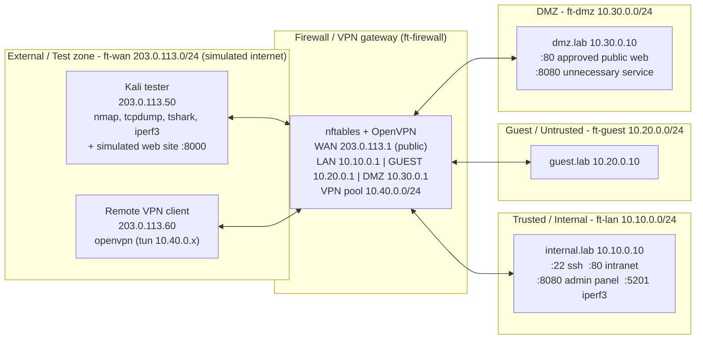

# Network Background and System Allocation (SRS 1.2 / 1.4 / FR i)

## Topology

Every non-gateway system has its **default route set to the gateway's IP in its own zone**, so all inter-zone traffic must traverse the firewall. The gateway has **no default route** (nothing can leave the lab).

## System Allocation Table

| System / container | Purpose | Platform | Security zone | IP / subnet | Interface / connection |
|---|---|---|---|---|---|
| ft-firewall | Firewall, NAT, VPN gateway, logging | Ubuntu 24.04 container: nftables 1.0.x, OpenVPN 2.6 | all (border) | 203.0.113.1/24, 10.10.0.1/24, 10.20.0.1/24, 10.30.0.1/24, tun0 10.40.0.1/24 | 4 veths -> bridges ft-wan, ft-lan, ft-guest, ft-dmz |
| ft-internal | Protected internal server (intranet web, SSH, admin panel, iperf3 server) | Ubuntu 24.04 container: nginx, openssh, python http, iperf3 | Trusted / Internal | 10.10.0.10/24, gw 10.10.0.1 | eth0 -> ft-lan |
| ft-guest | Guest/untrusted device | Ubuntu 24.04 container | Guest / Untrusted | 10.20.0.10/24, gw 10.20.0.1 | eth0 -> ft-guest |
| ft-dmz | Public-facing web service (+ one unnecessary service) | Ubuntu 24.04 container: nginx, python http, iperf3 | DMZ | 10.30.0.10/24, gw 10.30.0.1 | eth0 -> ft-dmz |
| ft-kali | Authorized reconnaissance / testing; also hosts the "simulated internet website" (:8000) | Kali Linux rolling container: nmap, tcpdump, tshark, hping3, iperf3 | External / Test | 203.0.113.50/24, gw 203.0.113.1 | eth0 -> ft-wan |
| ft-vpnclient | Remote user (tests with and without VPN) | Ubuntu 24.04 container: openvpn, curl, iperf3 | External / Test (remote) | 203.0.113.60/24, gw 203.0.113.1; tunnel 10.40.0.10 (admin) / 10.40.0.20 (staff) | eth0 -> ft-wan, tun0 |
| Ubuntu VM (VMware) | Docker host, packet capture point, kernel-log collector | Ubuntu 24.04 + Docker | management only | 203.0.113.254, 10.10.0.254, 10.20.0.254, 10.30.0.254 (bridge addresses, excluded from tests) | bridges ft-wan / ft-lan / ft-guest / ft-dmz |

## IP addressing and segmentation plan

| Zone | Network | Mask | Gateway (firewall) | Firewall interface | Notes |
|---|---|---|---|---|---|
| External / Test | 203.0.113.0 | /24 | 203.0.113.1 (public IP) | WAN | TEST-NET-3 documentation range: looks public, never routed on the real internet |
| Trusted / Internal | 10.10.0.0 | /24 | 10.10.0.1 | LAN | |
| Guest / Untrusted | 10.20.0.0 | /24 | 10.20.0.1 | GUEST | |
| DMZ | 10.30.0.0 | /24 | 10.30.0.1 | DMZ | |
| VPN client pool | 10.40.0.0 | /24 | 10.40.0.1 (tun0) | tun0 | admin = 10.40.0.10, staff = 10.40.0.20 (static via OpenVPN CCD); not a zone |

VLAN IDs: not used (each zone is a separate Linux bridge, which is the equivalent L2 separation in a virtualized lab).

## Permitted / blocked communication paths (hardened modes)

| From -> To | Policy | Enforced by |
|---|---|---|
| Internal -> DMZ web :80, iperf3 :5201, ICMP | allow | forward rules `lan-to-dmz-*` |
| Internal -> External | allow + masquerade | `lan-to-wan`, `outbound-nat` |
| Guest -> External | allow + masquerade | `guest-to-wan` |
| Guest -> Internal, Guest -> DMZ | **block + log** | `guest-isolation`, `guest-no-dmz` |
| External -> public IP :80 -> DMZ web | allow (port-forward only) | `portfwd-dmz-web` + `ext-to-dmz-web` (`ct status dnat`) |
| External -> Internal, External -> other DMZ ports | **block + log** | `ext-to-lan-blocked`, `ext-to-dmz-other-blocked`, input default deny |
| DMZ -> Internal | **block + log** | `dmz-to-lan-blocked` |
| DMZ -> External | allow + masquerade | `dmz-to-wan` |
| Remote -> Internal without VPN | **block + log** | `ext-to-lan-blocked` |
| VPN admin (10.40.0.10) -> Internal :22 :80 :8080 :5201 | allow + log | `vpn-admin-full-access` |
| VPN staff (10.40.0.20) -> Internal :80 | allow + log | `vpn-staff-web-only` |
| VPN staff -> Internal :22 :8080; any VPN user -> other zones | **block + log** | `vpn-unauthorized-resource` |
| Anything else | block + log | `forward-default-deny` |

In **Minimal Protection** the gateway is a plain router: no NAT, no filtering, every path above is allowed and nothing is logged (counters only).
